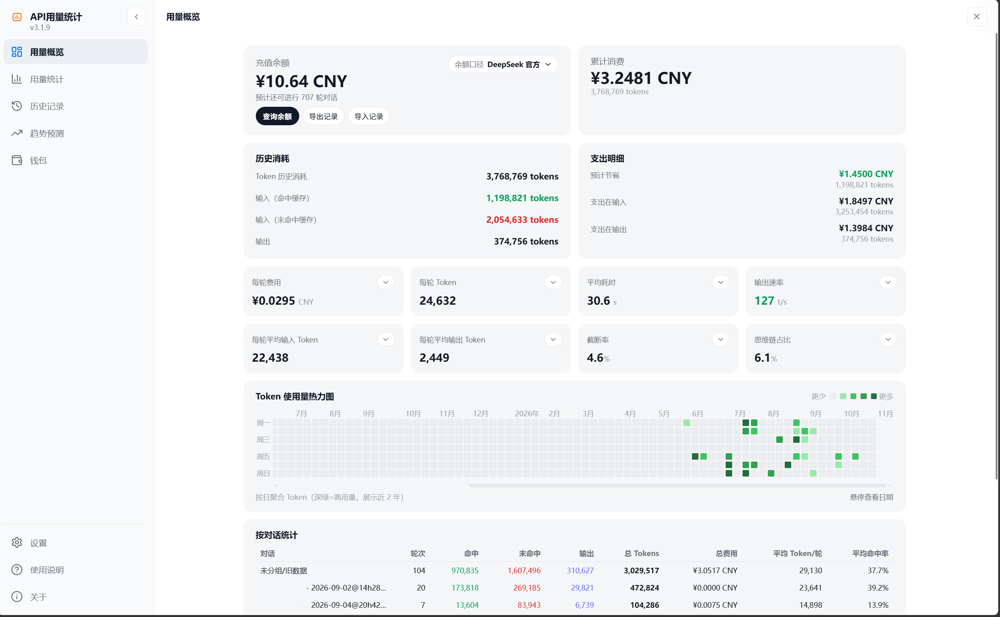

# API 用量统计

> SillyTavern 扩展：为 DeepSeek 与兼容接口记录每一次调用的 Token、费用、缓存与响应表现。

自动记录请求数据，提供**用量概览、多维统计、历史明细、趋势预测与多钱包管理**。纯前端本地运行，数据默认只保存在本机。

[使用文档](https://janmk1453.github.io/Api-Usage/) · [安装](#安装) · [隐私声明](https://janmk1453.github.io/Api-Usage/#privacy) · [问题反馈](https://github.com/janmk1453/Api-Usage/issues)

## 界面预览

[](docs/images/overview.png)

<p align="center"><sub>用量概览 · 余额与消费、Token 构成、8 项指标、近两年热力图与按对话统计</sub></p>

<table width="100%">
  <tr>
    <td width="50%" align="center"><a href="docs/images/stats-summary.png"></a></td>
    <td width="50%" align="center"><a href="docs/images/stats-charts.png"></a></td>
  </tr>
  <tr>
    <td width="50%" align="center"><sub><b>用量统计 · 汇总</b><br>五维筛选、模型汇总与自定义图表</sub></td>
    <td width="50%" align="center"><sub><b>用量统计 · 图表</b><br>缓存命中、请求数、耗时/速率与模型占比</sub></td>
  </tr>
</table>

<table width="100%">
  <tr>
    <td width="50%" align="center"><a href="docs/images/history.png"></a></td>
    <td width="50%" align="center"><a href="docs/images/forecast.png"></a></td>
  </tr>
  <tr>
    <td width="50%" align="center"><sub><b>历史记录</b><br>逐次调用明细、缓存断点对比与四类原始数据详情</sub></td>
    <td width="50%" align="center"><sub><b>趋势预测</b><br>下一轮用量与成本、压缩点、余额与上下文可支撑轮数</sub></td>
  </tr>
</table>

## 核心功能

- **用量概览**：充值余额、累计消费、Token 构成与每轮均值，并附近两年使用热力图与按对话汇总。
- **用量统计**：按时间、模型、对话、接入类型与 API 密钥五维筛选，查看消费与请求量，并用图表对比不同模型与时段。
- **历史记录**：逐条明细含 Token、费用、耗时、速率与缓存占比，可展开查看请求参数、响应原文、Raw 用量、消息内容与新旧缓存断点对比。
- **趋势预测**：按单个对话预测下一轮用量与成本，给出预测区间、上下文压缩点、余额与上下文可支撑轮数、模型效率与能耗评分。
- **多钱包**：按接入地址分钱包管理余额、密钥标识、模型价格与峰谷规则，支持手工余额与多家厂商的余额自动校准。
- **计价与数据**：内置 DeepSeek 官方峰谷价与中国法定节假日定价，支持价格同步、套餐额度查看、导入导出与 WebDAV 同步。
- **Agent 模式**：在 TauriTavern 下自动采集 Agent 模式的模型用量，历史行标注为 `Agent` 或 `常规`。

## TauriTavern Agent 模式

在 [TauriTavern](https://github.com/Darkatse/TauriTavern) 宿主下自动启用：一次 Agent 运行记一条历史，Token 与费用为各回合之和。上游原版 SillyTavern 下不启用，记录方式与之前一致。

## 安装

需要 SillyTavern **1.11.0** 及以上。在「扩展程序 → 安装扩展程序」中粘贴 `https://github.com/janmk1453/Api-Usage` 安装，刷新后在魔法棒菜单中打开「API 用量统计」。

## 隐私与数据

纯前端、本地运行，历史、设置与钱包配置只保存在本机。默认开启的匿名使用统计只上报环境与使用次数等分桶信息，不含对话内容、模型名与密钥，可随时关闭并重置匿名标识，详见[隐私声明](https://janmk1453.github.io/Api-Usage/#privacy)。

## 构建

```bash
npm install
npm run typecheck && npm test
npm run build && node --check index.js
npm run verify:ci
```

## 致谢

部分实现参考了 [cone97218-alt/ds](https://github.com/cone97218-alt/ds)，在此致谢。

## 许可证

[MIT](LICENSE)
